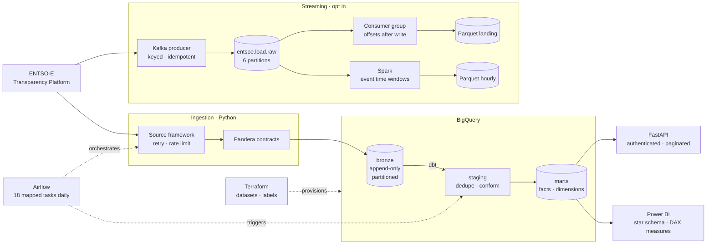
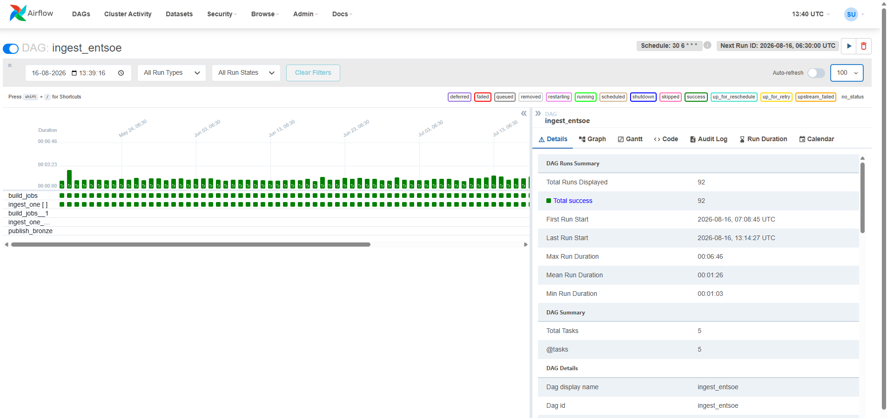
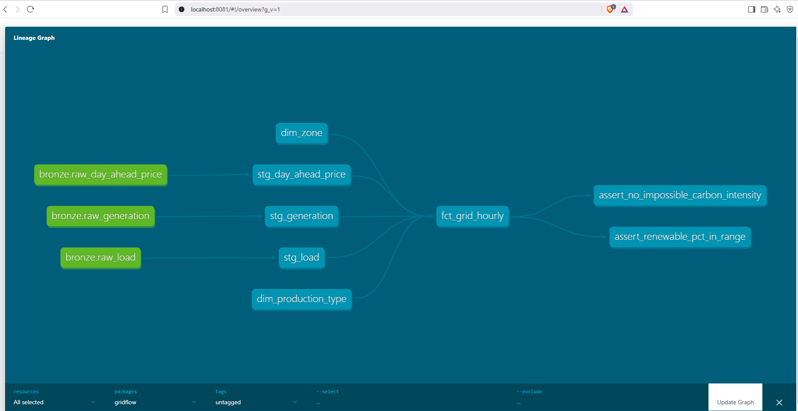
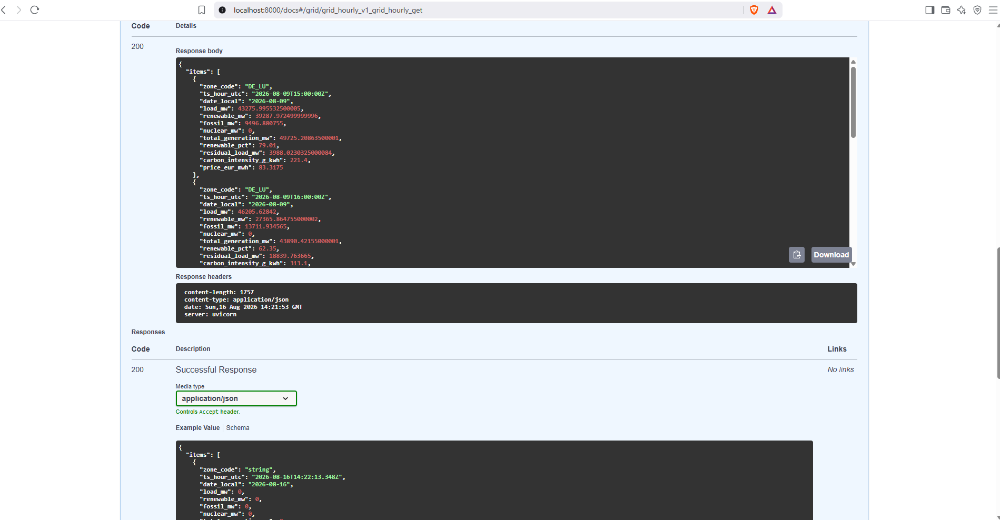
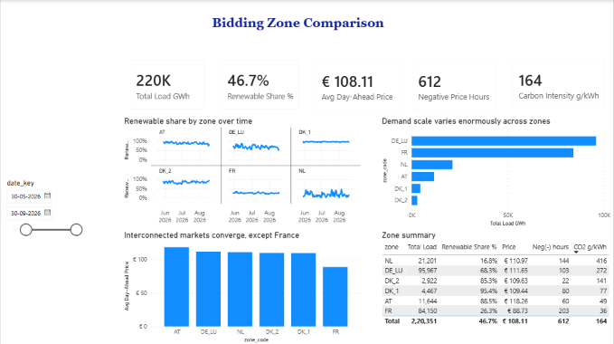
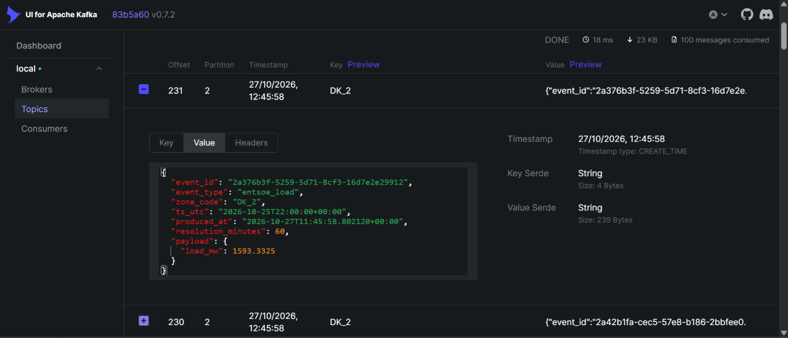

# entsoe-data-platform


Electricity load, generation mix and day-ahead prices for six European bidding
zones, pulled from the ENTSO-E Transparency Platform into BigQuery, modelled
with dbt and run on Airflow.



**Status:** the batch pipeline, the Kafka and Spark path over the same source,
and the comparison between them all run. The BigQuery datasets are managed in
Terraform. Containerising for Kubernetes is the next piece.

## Stack

Python 3.11 · BigQuery · dbt · Airflow 2.9 · Kafka · Spark · Terraform · FastAPI · Power BI · Docker · Pandera · pytest · GitHub Actions

## What it does

- Pulls load, generation by production type and day-ahead prices for DE_LU, AT,
  NL, FR, DK_1 and DK_2
- Validates every frame against a Pandera contract before it reaches BigQuery
- Lands it in an append-only bronze layer, then dedupes revisions and conforms
  mixed source resolutions to hourly in dbt
- Builds a fact table with renewable share, residual load and carbon intensity,
  covered by 14 data tests
- Runs daily in Airflow across 18 mapped tasks, then triggers the dbt build
  through a Dataset, so neither DAG has to know about the other
- Serves the marts over FastAPI with key auth and cursor pagination
- Mirrors the same source onto a Kafka topic, lands it with a consumer group that
  commits offsets after the write, and windows it in Spark on event time
- Warns when an hour or a market day arrives short, which no other check catches
- Manages the BigQuery datasets in Terraform, imported rather than recreated

14,786 hourly rows so far, 107 days across 6 zones.

## Orchestration



One task per zone and source, so a dead feed fails alone instead of taking the
run down with it. A three month backfill ran 1,799 tasks without a failure.

## Warehouse lineage



## API



Read-only endpoints over the marts, key auth, cursor pagination, and a byte
ceiling per query so a bad request cannot run up a bill.

## Semantic layer



Power BI over a dbt star schema at zone and hour grain. Ratios are kept out of
the fact table and written as DAX measures over additive numerators. Averaging a
stored `renewable_pct` gives you the mean of hourly percentages; dividing total
renewable by total generation gives you the share for the period. Only the
second is right at any grain above an hour.

## Streaming layer



A second path over the same source, meant for comparison with the batch one
rather than as a replacement. A producer polls ENTSO-E and publishes one event
per zone and interval, a consumer group lands them as partitioned Parquet, and a
Spark job aggregates the same topic into hourly windows on event time.

```bash
docker compose --profile streaming up -d   # Kafka, UI on localhost:8081
gridflow-produce --zones DE_LU
gridflow-consume                           # lands to data/stream/load
make spark-hourly                          # aggregates into hourly windows
```

ENTSO-E is not an event stream. The API hands back a whole market day in one
response and the producer fans it out, so this is stream shaped ingestion over a
polled source, not telemetry. What it does exercise is the part that transfers:
partitioning, keyed ordering, at-least-once delivery, and event time against
processing time.

Events are keyed on `zone_code`, so everything for a zone lands on one partition
and stays in order there. Kafka orders inside a partition and nowhere else. Six
keys over six partitions did not spread evenly: AT, FR, DE_LU and NL each took
one, DK_1 collided with DE_LU, DK_2 with FR, and two partitions sat empty.
Keying buys ordering, not balance.

The two timestamps on every event are far apart on purpose. `ts_utc` comes from
the reading, `produced_at` from the poll, and in the screenshot above they are 37
hours apart. Anything windowing on arrival time would drop a whole day into one
bucket, which is what makes the watermark in the Spark job a real decision.

The consumer has auto commit off and commits offsets after the Parquet write,
never before. Auto commit runs on a timer and has no idea whether a message was
handled, so a crash in between loses it silently. Committing afterwards turns
that into redelivery instead, and duplicates are fixable where loss is not.

Nothing is deduplicated on write. A redelivered batch lands as a second file and
the read collapses it, keeping the latest `produced_at` per `event_id`, which is
the same rule staging applies to bronze in BigQuery. That works because
`event_id` is a UUID5 over event type, zone and timestamp, so a republished day
carries the same ids rather than looking like new data.

The producer runs idempotent, which pins `acks=all` and keeps a retry from
duplicating or reordering, and it raises if `flush()` leaves anything unsent.
JSON for now; Avro and a schema registry can wait until something depends on the
schema.

A Spark Structured Streaming job reads the same topic and aggregates load into
hourly windows on event time. It runs in local mode in a container, because the
volume here needs nothing more and a real cluster would not fit beside Airflow.

**Spark keeps its own offsets.** Not in a consumer group, in the checkpoint
directory, alongside the aggregation state. So the hand written consumer and the
Spark job read the same topic without seeing each other, and deleting the
checkpoint replays everything regardless of what any group has committed.

**The watermark is the whole decision.** It advances with the largest event time
seen, never with the clock, and a poll publishes a market day in one go, so it
jumps to the end of that day the moment the batch lands. Publish an earlier day
afterwards and those events arrive a day behind the watermark and are discarded.
The job prints how many it dropped. A file sink also supports append only, so the
watermark alone decides when a window is final, which means the newest windows
stay in state rather than being written. Both of those are the trade being made
visible rather than bugs.

**The two paths are compared on the same day, not assumed to agree.**

```bash
gridflow-compare --day 2026-10-26 --out diff.csv
```

A full outer join of `stg_load` in BigQuery against the Spark output on zone and
hour, so neither side can hide the other's gaps. Three kinds of difference show
up, and each one means something specific.

Measured on 26 October for DE_LU: 24 hours from BigQuery, 21 from Spark, and the
21 shared hours agree to 7.3e-12 MW. That residue is floating point, the two
engines summing in a different order, so the streaming path is arithmetically
correct. The three missing hours are the watermark holding the newest windows
open. Interval counts matched everywhere.

**Which makes the honest conclusion a negative one.** ENTSO-E publishes a market
day in one response, hours after the fact, so the freshest a streaming path can
be is the freshest the publisher is. Batch delivers the complete day; streaming
delivers 21 of the same 24 hours and calls it low latency. Streaming earns its
place when a source emits events as they happen. This one does not, and building
both was the only way to say that with numbers rather than opinion.

One difference the comparison has not surfaced yet, because no revision has
landed since: the two paths resolve a republished day by different rules. Bronze
keeps the row with the latest `ingested_at`, while Spark's `dropDuplicates` keeps
whichever copy of an `event_id` arrived first. When ENTSO-E revises a value the
batch path will take the new number and the stream path will keep the old one.

## Infrastructure as code

The BigQuery datasets were created by hand, through the console and a SQL
migration. Terraform adopts them rather than recreating them.

```bash
cp terraform/terraform.tfvars.example terraform/terraform.tfvars   # add the project id
terraform -chdir=terraform init
terraform -chdir=terraform import google_bigquery_dataset.bronze  <project>/bronze
terraform -chdir=terraform import google_bigquery_dataset.staging <project>/gridflow_staging
terraform -chdir=terraform import google_bigquery_dataset.marts   <project>/gridflow_marts
terraform -chdir=terraform plan
```

**Terraform owns the datasets and nothing inside them.** Table DDL stays with the
SQL migrations and dbt. Two systems that both believe they own a table is how
people lose one, so the boundary is drawn at the dataset.

**Every dataset carries `prevent_destroy` and `delete_contents_on_destroy = false`.**
A `terraform destroy` against a misconfigured workspace would otherwise take the
whole warehouse, and the only way back is refetching months of data from an API
that does not keep all of it. Two independent brakes rather than one.

**Importing surfaced drift nobody had recorded.** The first apply updated two
datasets and was refused on the third. The service account held dataset level
ownership of the two dbt created, because BigQuery writes the creator into a
dataset's access list, but only project level `dataEditor` on bronze, which does
not grant `bigquery.datasets.update`. Three datasets that looked identical had
different permissions because they were made by different means months apart.
Nothing was going to reveal that until something tried to reconcile them.

**Credentials come from `GOOGLE_APPLICATION_CREDENTIALS`,** the same service
account key the pipeline already uses, so there is no second auth path to keep in
step. State is local and gitignored for now; a GCS backend is the obvious next
step and needs a bucket the service account cannot currently create.

## Design notes

**Market days are not always 24 hours.** A trading day runs local midnight to
local midnight in Europe/Berlin, so it is 23 hours in spring and 25 in autumn.
The window is returned in UTC because Python does naive arithmetic when
subtracting two datetimes that share a `tzinfo`, which silently swallows the
offset change. A test written before the implementation caught that.

**Bronze is append only.** ENTSO-E revises values after publication, so a re-run
writes a new version with a fresh `ingested_at` instead of overwriting. Staging
picks the latest with `row_number()` over the natural key, which makes replays
and backfills safe at any time.

**Partition filters are required.** BigQuery bills on bytes scanned, so bronze
tables set `require_partition_filter` and a query with no date predicate is
rejected. Making the expensive query impossible beats documenting that it is
discouraged.

**Renewable share is a poor proxy for emissions.** France has the lowest
renewable share of the six zones at 27% and the lowest carbon intensity at
35 g/kWh, because nuclear is not renewable but is close to carbon free. The
Netherlands sits at 17% renewable and 410 g/kWh. Ranking zones on renewable
share alone inverts the emissions picture.

**Every gap in the data is Danish.** 14 incomplete zone-days out of 624, all of
them DK_1 and DK_2, on the same seven dates with the same hour counts in both
zones each time. That is one publisher rather than two feeds. Three are isolated,
in May, June and August; the other four run consecutively from 24 to 27 October,
each five or six hours short, so it is a current degradation rather than history.
No hour ever arrives partial, only absent, which is why the interval count test
passes and the hours per day test does not. Both were needed to see it.

**The conventional peak window no longer holds the peak.** European markets call
08:00 to 20:00 CET peak, but day-ahead prices now peak in the evening ramp once
solar drops off. Over four months, off-peak beat peak by about €69/MWh. The
measures follow the market definition and the report says so, instead of moving
the window to tidy the numbers.

## Local setup

```bash
git clone https://github.com/suhasnu/entsoe-data-platform.git
cd entsoe-data-platform
py -3.11 -m venv .venv && .venv\Scripts\Activate.ps1
pip install -e ".[dev]"
cp .env.example .env        # fill in ENTSOE_API_KEY and GCP_PROJECT_ID
python -m gridflow.storage.migrate
docker compose up -d        # Airflow at localhost:8080
pytest
```

Needs an ENTSO-E API key (request from transparency@entsoe.eu) and a Google Cloud
service account with BigQuery Data Editor and Job User.

Give Docker at least 6 GB. On Windows with the WSL2 backend that goes in
`~/.wslconfig`, not Docker Desktop's settings panel. Below that the scheduler
cannot spawn workers fast enough and Airflow fails queued tasks before they ever
start, with no start timestamp to show for it.

## Known gaps

- Failed rows raise instead of being quarantined with a reason
- Marts rebuild in full, which stops scaling past a few million rows
- dbt in CI only checks that models compile
- No alerting on failure
- Terraform state is a local file rather than a GCS backend, and it covers the
  datasets only. Service accounts, IAM bindings and buckets are still created by
  hand, because the service account it runs as cannot manage them
- Kafka has no volume, so topics go on `docker compose down`
- The landing zone grows a file per batch and is never compacted
- The Spark job has no test coverage; it is verified by running it
- The stream path cannot resolve a revision. `event_id` identifies a measurement,
  so a revised value arrives under the same id with different content, and
  `dropDuplicates` keeps whichever copy came first. Bronze keeps the latest
  `ingested_at` and the Parquet landing keeps the latest `produced_at`, so both
  of those are right and Spark is not. Structured Streaming has no "keep the
  newest by another column" deduplication, and a plain Parquet sink cannot update
  a row it already wrote. The real fixes are a log compacted topic keyed on the
  measurement, or a sink that supports merge such as Delta or Iceberg. The
  comparison tool reports the divergence as `load_disagreements`
- Incomplete days are detected but not repaired. Two dbt tests warn when an hour
  holds the wrong number of intervals or a market day the wrong number of hours,
  but nothing re-ingests a day once loaded, so a gap stays one

## Data licensing

Electricity data © ENTSO-E Transparency Platform, used under its terms of use.
No personal data is processed.