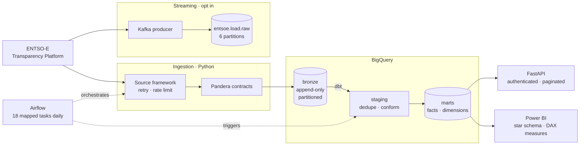

# entsoe-data-platform


Electricity load, generation mix and day-ahead prices for six European bidding
zones, pulled from the ENTSO-E Transparency Platform into BigQuery, modelled
with dbt and run on Airflow.



**Status:** ingestion, warehouse, orchestration and the API work end to end. A
Kafka path over the same source is in progress, so the two can be compared on
the same data.

## Stack

Python 3.11 · BigQuery · dbt · Airflow 2.9 · Kafka · FastAPI · Power BI · Docker · Pandera · pytest · GitHub Actions

## What it does

- Pulls load, generation by production type and day-ahead prices for DE_LU, AT,
  NL, FR, DK_1 and DK_2
- Validates every frame against a Pandera contract before it reaches BigQuery
- Lands it in an append-only bronze layer, then dedupes revisions and conforms
  mixed source resolutions to hourly in dbt
- Builds a fact table with renewable share, residual load and carbon intensity,
  covered by 14 data tests
- Runs daily in Airflow across 18 mapped tasks, then triggers the dbt build
  through a Dataset, so neither DAG has to know about the other
- Serves the marts over FastAPI with key auth and cursor pagination

13,096 hourly rows so far, 91 days across 6 zones.

## Orchestration


One task per zone and source, so a dead feed fails alone instead of taking the
run down with it. A three month backfill ran 1,799 tasks without a failure.

## Warehouse lineage


## API


Read-only endpoints over the marts, key auth, cursor pagination, and a byte
ceiling per query so a bad request cannot run up a bill.

## Semantic layer


Power BI over a dbt star schema at zone and hour grain. Ratios are kept out of
the fact table and written as DAX measures over additive numerators. Averaging a
stored `renewable_pct` gives you the mean of hourly percentages; dividing total
renewable by total generation gives you the share for the period. Only the
second is right at any grain above an hour.

## Streaming layer


A second path over the same source, meant for comparison with the batch one
rather than as a replacement. A producer polls ENTSO-E and publishes one event
per zone and interval; a consumer group lands them as partitioned Parquet.

```bash
docker compose --profile streaming up -d   # Kafka, UI on localhost:8081
gridflow-produce --zones DE_LU
gridflow-consume                           # lands to data/stream/load
```

ENTSO-E is not an event stream. The API hands back a whole market day in one
response and the producer fans it out, so this is stream shaped ingestion over a
polled source, not telemetry. What it does exercise is the part that transfers:
partitioning, keyed ordering, at-least-once delivery, and event time against
processing time.

Events are keyed on `zone_code`, so everything for a zone lands on one partition
and stays in order there. Kafka orders inside a partition and nowhere else. Six
keys over six partitions did not spread evenly: AT, FR, DE_LU and NL each took
one, DK_1 collided with DE_LU, DK_2 with FR, and two partitions sat empty.
Keying buys ordering, not balance.

The two timestamps on every event are far apart on purpose. `ts_utc` comes from
the reading, `produced_at` from the poll, and in the screenshot above they are 37
hours apart. Anything windowing on arrival time would drop a whole day into one
bucket, which is what makes the watermark in the Spark job a real decision later.

The consumer has auto commit off and commits offsets after the Parquet write,
never before. Auto commit runs on a timer and has no idea whether a message was
handled, so a crash in between loses it silently. Committing afterwards turns
that into redelivery instead, and duplicates are fixable where loss is not.

Nothing is deduplicated on write. A redelivered batch lands as a second file and
the read collapses it, keeping the latest `produced_at` per `event_id`, which is
the same rule staging applies to bronze in BigQuery. That works because
`event_id` is a UUID5 over event type, zone and timestamp, so a republished day
carries the same ids rather than looking like new data.

The producer runs idempotent, which pins `acks=all` and keeps a retry from
duplicating or reordering, and it raises if `flush()` leaves anything unsent.
JSON for now; Avro and a schema registry can wait until something depends on the
schema.

## Design notes

**Market days are not always 24 hours.** A trading day runs local midnight to
local midnight in Europe/Berlin, so it is 23 hours in spring and 25 in autumn.
The window is returned in UTC because Python does naive arithmetic when
subtracting two datetimes that share a `tzinfo`, which silently swallows the
offset change. A test written before the implementation caught that.

**Bronze is append only.** ENTSO-E revises values after publication, so a re-run
writes a new version with a fresh `ingested_at` instead of overwriting. Staging
picks the latest with `row_number()` over the natural key, which makes replays
and backfills safe at any time.

**Partition filters are required.** BigQuery bills on bytes scanned, so bronze
tables set `require_partition_filter` and a query with no date predicate is
rejected. Making the expensive query impossible beats documenting that it is
discouraged.

**Renewable share is a poor proxy for emissions.** France has the lowest
renewable share of the six zones at 27% and the lowest carbon intensity at
35 g/kWh, because nuclear is not renewable but is close to carbon free. The
Netherlands sits at 17% renewable and 410 g/kWh. Ranking zones on renewable
share alone inverts the emissions picture.

**The conventional peak window no longer holds the peak.** European markets call
08:00 to 20:00 CET peak, but day-ahead prices now peak in the evening ramp once
solar drops off. Over four months, off-peak beat peak by about €69/MWh. The
measures follow the market definition and the report says so, instead of moving
the window to tidy the numbers.

## Local setup

```bash
git clone https://github.com/suhasnu/entsoe-data-platform.git
cd entsoe-data-platform
py -3.11 -m venv .venv && .venv\Scripts\Activate.ps1
pip install -e ".[dev]"
cp .env.example .env        # fill in ENTSOE_API_KEY and GCP_PROJECT_ID
python -m gridflow.storage.migrate
docker compose up -d        # Airflow at localhost:8080
pytest
```

Needs an ENTSO-E API key (request from transparency@entsoe.eu) and a Google Cloud
service account with BigQuery Data Editor and Job User.

Give Docker at least 6 GB. On Windows with the WSL2 backend that goes in
`~/.wslconfig`, not Docker Desktop's settings panel. Below that the scheduler
cannot spawn workers fast enough and Airflow fails queued tasks before they ever
start, with no start timestamp to show for it.

## Known gaps

- Failed rows raise instead of being quarantined with a reason
- Marts rebuild in full, which stops scaling past a few million rows
- dbt in CI only checks that models compile
- No alerting on failure
- Kafka has no volume, so topics go on `docker compose down`
- The landing zone grows a file per batch and is never compacted
- Days arrive incomplete and get revised later. DK_1 load for 2026-10-25 came
  with 16 of 25 hourly intervals, and nothing re-ingests a day once loaded.
  Pandera checks types, ranges and uniqueness, not completeness

## Data licensing

Electricity data © ENTSO-E Transparency Platform, used under its terms of use.
No personal data is processed.